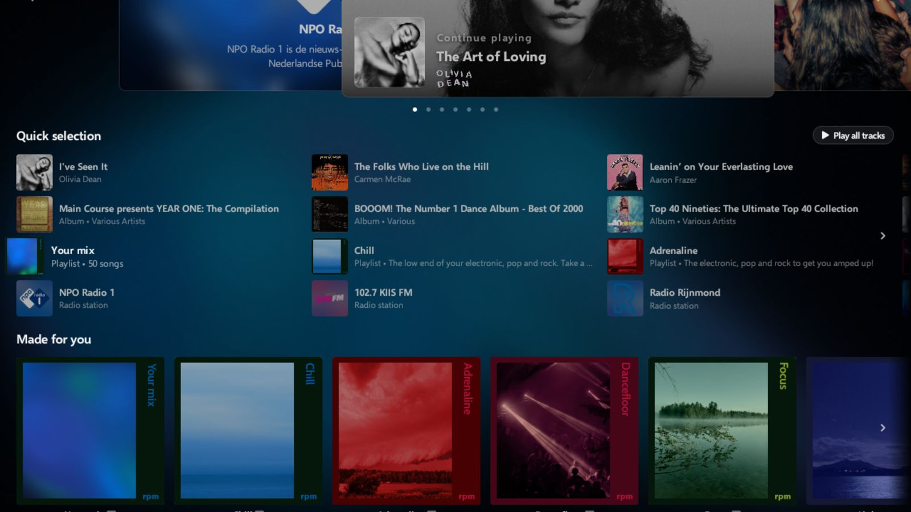
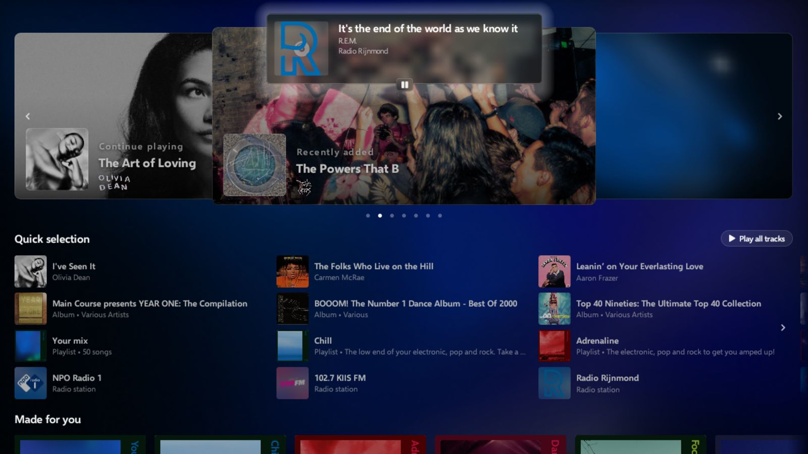

# rpm for Android

The rpm music player for Android phones and Android TV.

Part of [rpm](https://github.com/rpmrpmrpm/rpm). Ideas and questions go to the
[discussions](https://github.com/rpmrpmrpm/rpm/discussions) there.

<p align="center">
  
</p>
<p align="center">
  
  
</p>

The Android TV app: Home, Home scrolled down to Your mix, and a radio station playing. More on
[rpmrpmrpm.com](https://rpmrpmrpm.com/tv). The record covers and photographs in the screenshots
belong to their owners; the code licence does not cover them.

## What is here

The project is in `RPM.Android/`.

| Module | What it is |
| --- | --- |
| `core` | Shared by both apps: library, playback (Media3), casting, radio, the rpm server client. |
| `phone` | The phone app (Jetpack Compose). |
| `tv` | The Android TV app (Compose for TV). |
| `ffmpeg` | The Media3 FFmpeg decoder (Apache 2.0), for formats Android cannot play itself. |

## Build

You need JDK 17 or later and the Android SDK with the Android 17 platform (API 37). Android Studio
installs both. The apps run on Android 9 (API 28) or later.

Gradle has to know where the SDK is. Android Studio writes it into `RPM.Android/local.properties`
when you open the project. To build from the command line without opening Studio first, set
`ANDROID_HOME` to the SDK folder, or create `RPM.Android/local.properties` with one line (the file
is not committed):

```
sdk.dir=/path/to/Android/sdk
```

On Windows, write the path with forward slashes or doubled backslashes, for example
`sdk.dir=C:/Users/you/AppData/Local/Android/Sdk`.

Then build and test:

```
cd RPM.Android
./gradlew :phone:assembleDebug
./gradlew :tv:assembleDebug
./gradlew test
```

Without the FFmpeg libraries the `ffmpeg` module builds empty, and the apps play the formats Android
supports itself. To include them, build them with `scripts/build-android-ffmpeg.sh` and set
`rpm.ffmpegRoot` in `~/.gradle/gradle.properties`. That build also needs NDK 27.2.12479018.

The local library and playback work without an account. The cloud library, catalogue pages and
recognition need an rpm account.

## Licence

[Mozilla Public License 2.0](LICENSE). Third-party files keep their own licence. The name and logo
are reserved: see [TRADEMARKS.md](TRADEMARKS.md).
